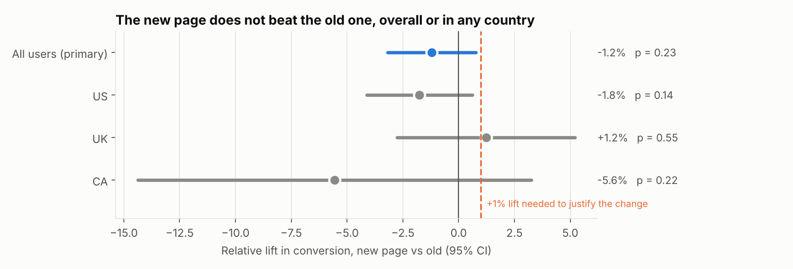
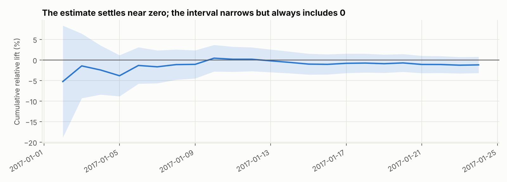
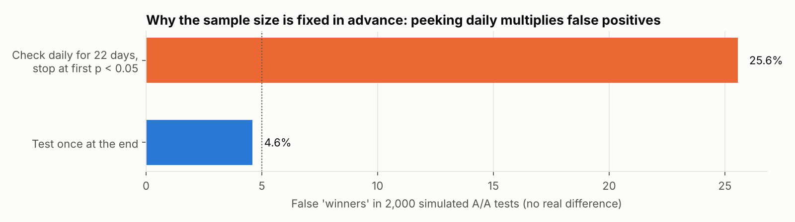

# A/B Test Analysis: Should We Ship the New Landing Page?

[](https://github.com/Mallika56/ab-test-checkout-analysis/actions/workflows/ci.yml)

A complete experiment readout on **294,478 user sessions** from an e-commerce landing-page A/B test.
It runs from data-integrity checks to a one-page ship / don't-ship decision, the way a product analyst
would present it.

`Python` `SQL` `Statistics` `Hypothesis testing` `Power analysis` `Bayesian A/B testing` `pandas` `statsmodels` `DuckDB`

**→ [Read the one-page decision memo](docs/decision_memo.md)**

---

## Answer: don't ship



| | Users | Conversion |
|---|---|---|
| Old page (control) | 143,293 | 12.02% |
| New page (treatment) | 143,397 | 11.87% |
| **Relative lift** | | **−1.2%** (95% CI −3.2% to +0.8%, p = 0.23) |

The upper end of the confidence interval (+0.8%) is below the **+1% lift set as the minimum worth
shipping**, so the data rules out the improvement the business was looking for. Bayesian
probability that the new page is better: **11.6%**.

## How the analysis works

The order matters. Validity first, results second.

| Step | Question | Method | Finding |
|---|---|---|---|
| 1. Integrity | Is the log trustworthy? | pandas + SQL (DuckDB) cross-check | 3,893 rows show the wrong page for the group; all belong to **3,894 users logged twice**, 1,895 of them in **both** groups |
| 2. Cleaning | Which users count? | Exclude contaminated users (primary); keep-first-aligned-row (sensitivity) | 286,690 clean users; contamination split evenly across arms (3,909 vs 3,879 rows) |
| 3. Randomization | Did the 50/50 split work? | Sample-ratio-mismatch chi-square | 49.98% / 50.02%, p = 0.85 ✓ |
| 4. Design | What could this test detect? | Power analysis (α = 0.05, 80% power) | MDE ≈ **2.8% relative** at this sample size; +1% would need 1.15M users per arm |
| 5. Primary test | Is there a difference? | Two-proportion z-test, Wald CI | −1.2%, p = 0.23 |
| 6. Robustness | Does the answer depend on choices? | Alternative cleaning; Bayesian Beta-Binomial; time split; country segments with Holm correction + logistic interaction test | Same conclusion every way |
| 7. Decision | Ship? | CI vs pre-set practical threshold | CI upper bound < +1%, so **don't ship** |

### Stable over time, no novelty effect



Early days swing widely, which is why you don't stop early. The estimate settles around −1%, and the
95% interval includes zero on every day. First half: −0.2%; second half: −2.2%.

### No hidden winning segment

US −1.8% (p = 0.14), UK +1.2% (p = 0.55), Canada −5.6% (p = 0.22). After Holm correction for three
comparisons none is close to significant, and a logistic regression interaction test
(variant × country) gives p = 0.27. Reporting the UK as a "win" would be cherry-picking.

### Why the test length is fixed in advance



2,000 simulated A/A tests (no real difference) with this experiment's traffic and baseline:
**testing once** gives false winners 4.6% of the time, close to the promised 5%. **Checking every day and
stopping at the first p < 0.05** gives false winners **25.6%** of the time.

## Data-quality story

The raw log has two problems that most quick analyses handle silently: misaligned rows and duplicate
users. Digging in showed they're the same problem. **Every** misaligned row belongs to a user logged
twice, and half of those users were logged in both groups. That points to an assignment or logging
bug, so we can't know which page those users really experienced.

* **Primary analysis:** exclude all 3,894 affected users (1.3%). Each remaining user has exactly one
  correct exposure.
* **Sensitivity analysis:** the common fix (drop misaligned rows, keep each user's first) gives −1.3%,
  p = 0.19. **Same decision.**
* **Bias check:** affected rows are split evenly between arms (3,909 control vs 3,879 treatment), so the
  bug didn't favor one variant.
* The integrity counts are computed twice, in pandas and in SQL, and the script **fails if they
  disagree**.

## Project structure

```
src/abtest/data.py      loading, integrity report, two cleaning strategies
src/abtest/stats.py     SRM, power/MDE, z-test + CI, Bayesian, Holm, peeking simulation
sql/                    integrity checks, daily and country conversion (DuckDB)
scripts/run_analysis.py the full readout -> docs/results/readout.json + charts
tests/                  14 tests: our formulas vs statsmodels/scipy, cleaning invariants
docs/decision_memo.md   the one-page recommendation
learn/walkthrough.md    plain-language guide with interview Q&A
```

## Run it

```bash
pip install -r requirements.txt
python -m pytest -q              # 14 tests
python scripts/run_analysis.py   # prints the readout, writes results + charts
```

CI verifies the data checksums, runs the tests and re-runs the full readout on every push.

## Data

The e-commerce landing-page experiment dataset from Udacity's Data Analyst Nanodegree, also
distributed on Kaggle. It covers 2–24 Jan 2017. The data is real-world in shape, but its
originating company isn't documented, so treat the business conclusions as illustrative. See
[`data/README.md`](data/README.md). The dataset has only one metric (conversion), so revenue and
other guardrail metrics couldn't be analyzed.

## What I'd add with richer data

* Guardrail metrics (revenue per visitor, bounce, page load time) and a sequential testing method
  (e.g. mSPRT) that allows safe early stopping.
* CUPED variance reduction using pre-experiment behavior, to detect smaller effects with the same traffic.
* Funnel-step analysis to find where the new page loses users.
